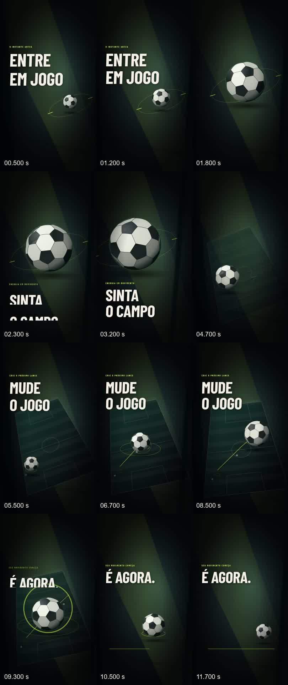
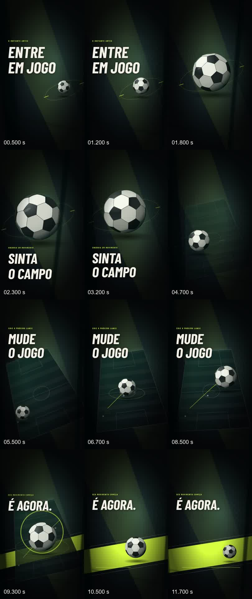

# M3.1 — Art Direction & Motion Refinement

Base inspecionada: PR #45, branch codex/creative-m3-motion-proof, commit
a89564e97cfea8373cfa0d954196354db0df54ef. Árvore inicialmente limpa.
Implementação: branch local codex/creative-m3-1-art-refinement, 26/10/2026.

**Entregue:** duas provas audiovisuais completas com som original.
**Estado editorial:** AWAITING_HUMAN_REVIEW. A escolha entre V1 e V2 permanece humana.
M4 não foi iniciado. Instalação principal, dados instalados, main e PR #45 não foram alterados.
Não houve serviço pago, publicação nem VPS.

## 1. Reutilização e escopo

O pipeline continua sendo CreativeReview → plano derivado em Job.payload → EDL v2 →
render_props → MediaGridTimelineV2 → Remotion → validação FFmpeg/FFprobe →
promoção protegida do artefato. A fila, lease, heartbeat, idempotência, staging
com hash, revalidação imediatamente antes e depois do encode são os mesmos do M3.

O preset sports_cinematic_v1 recebe duas variações. SportsRefinement é um componente
de overlay dentro da composição e das Sequences existentes. Não há outro renderer,
timeline, editor ou estrutura de projetos. O tempo global é calculado a partir do
tempo local do shot e start_ms, mantendo a continuidade entre as quatro Sequences.

Rotas existentes preservadas:

- POST /api/v1/projects/{id}/creative/motion/preview
- POST /api/v1/projects/{id}/creative/motion/render
- GET /api/v1/projects/{id}/creative/motion/jobs/{job_id}/video
- Polling, retry e cancelamento permanecem na infraestrutura de jobs.

Campos adicionais validados estritamente: art_direction (original/editorial/broadcast),
diagnostics (false por padrão), sound_design_asset_id (obrigatório e distinto da
trilha aprovada para as duas variações). A direção original continua disponível.
A tela Sports Motion oferece a seleção de direção, áudio e diagnóstico. Um vídeo
anterior só aparece como resultado atual quando o hash do plano corresponde à
prévia preparada, evitando confundir resultados de seleções diferentes.

## 2. Aprovação, áudio e persistência

A aprovação M1 inclui os assets do brief e do storyboard. Substituir a trilha
nesses documentos invalidaria o snapshot. Por isso:

1. A trilha aprovada original permanece na biblioteca e no snapshot, sem edição.
2. As duas trilhas novas entram como assets OWNED independentes, de 12 segundos,
   com autoria, permissão de uso e SHA-256.
3. O plano derivado contém tanto approved_soundtrack quanto derived_sound_design,
   seus IDs, hashes e direitos. O mixer usa o novo asset.
4. A nova trilha é uma escolha explícita do pedido de render; a aprovação de entrada
   não é apresentada como aprovação artística do novo áudio/vídeo.
5. O hash do plano inclui direção, diagnóstico, assets, aprovação, EDL e runtime.
   Alterar bytes ou direitos bloqueia execução/entrega. Cada direção tem seu job.
6. Project.edl, plan e script não são escritos. Nenhuma nova decisão de storyboard
   foi criada durante M3.1.

O script fez backup SQLite consistente com a origem aberta em mode=ro, copiando
apenas uma prova descartável sob data/creative-m3-proof. A implementação recusa
pastas de origem fora dessa área e destinos existentes ou fora de
data/creative-m3-1-proof. A origem não é o banco instalado.

Identidade preservada em ambas:

- Projeto: 98f5fce5-a612-4684-8b73-f460a404d655.
- Storyboard SHA-256: 58284939a9a0526d430fc29530c0cb7d8ae5be07f76805095acafa59b61317c7.
- Snapshot aprovado: 1f93f337029126e955a9d84aca9552784fbf3e8c00ae85d6fcb432aa1b4d2242.
- Banco M3 original, hash antes/depois:
  007e266dc05d9e0f281077044a4570f67500a613ad2b81964a34e235be46f962.

[Prova de isolamento](testing/creative-m3-1/isolation.json).
Head Alembic conferido: **0012_creative_direction**, único.
Sem schema/migração, nova dependência ou variável de ambiente; .env.example permanece válido.
PostgreSQL não foi executado nesta rodada; não houve mudança de persistência/schema.

O fingerprint do runtime muda com este refinamento: jobs derivados do código M3
anterior precisam ser derivados novamente para passar na validação da versão nova.
A aprovação do storyboard e os MP4s anteriores em disco continuam preservados.

## 3. Comparação de direção

| Aspecto | V1 — editorial | V2 — esportiva broadcast |
|---|---|---|
| Câmera | Arcos suaves e aproximação contínua | Reenquadramentos mais rápidos, inclinação e aproximações mais fortes |
| Profundidade | Arquitetura distante, bola/campo no plano médio, trilhos desfocados no primeiro plano | Mesmos planos, com maior deslocamento relativo |
| Tipografia | Entrada escalonada mais lenta, inclinação discreta, pausa de leitura | Entrada curta, escalonamento rápido e inclinação mais marcada |
| 0–2 s | Bola se aproxima enquanto o título libera o quadro | Aproximação acentuada e corte diagonal |
| 2–5 s | Órbita transforma-se em abertura de campo | Revelação mais rápida e expansão circular na passagem |
| 5–9 s | Trajeto e três contatos conduzem o olhar, câmera acompanha | Contatos com percussão e reenquadramentos mais expressivos |
| 9–12 s | Anel expansivo, recuo e assentamento da bola | Impacto de luz e faixa esportiva revelada atrás da bola |
| Som | Atmosfera grave, antecipações mais longas, reflexões discretas | Pulsos adicionais, subdivisões e acentos curtos |
| Encerramento | Respiro com deriva reduzida | Faixa de destaque e assentamento; sem movimento incessante |

Os textos e tempos aprovados continuam: ENTRE / EM JOGO (0–2), SINTA / O CAMPO (2–5),
MUDE / O JOGO (5–9), É AGORA. (9–12). Não há fatos, resultados ou clubes reais.

### Geometria, materiais e movimento

A bola é construída por truncamento de um icosaedro: 12 pentágonos e 20 hexágonos,
com interpolação esférica das bordas, rotação em dois eixos, projeção e ordenação
de faces. As normais orientam a iluminação; vinheta esférica, reflexo e sombra de
contato completam o volume. É uma esfera projetada em SVG, sem Blender/WebGL ou
render fisicamente baseado. A profundidade de cena é 2.5D com projeção por distância,
planos em z distintos, parallax e oclusão de elementos do primeiro plano.

A trajetória usa curvas determinísticas, sem estado de simulação. Partículas
esparsas e anéis reagem a contatos; a sombra muda com escala e altura aparente.
O campo aparece enquanto a órbita desaparece, conservando a mesma bola.
O último ato continua transformando posição, escala, anel e composição até assentar.

Títulos usam quadro de segurança x=108..950 e ficam independentes da rotação da câmera.
Máscaras são usadas apenas para entrada intencional; a saída foi antecipada para
evitar texto semitransparente atravessado pela bola em 1,8 s e 4,7 s.
Os cabeçalhos de laboratório, tempo e guias só aparecem com diagnostics=true.
Os dois arquivos finais estão em modo de produção, sem esses elementos.

## 4. Sound design e proveniência

scripts/m3_1_score.py sintetiza estéreo PCM 48 kHz/16 bits, com sementes fixas
3101/3102. Usa osciladores, ruído filtrado, envelopes, posicionamento estéreo
e duas reflexões discretas. Não usa samples, gravações, modelo de IA ou serviço externo.

Hierarquia: impactos de ato em 0/2/5/9 s; antecipações anteriores aos cortes;
contatos em 6,45/7,7 s; resolução harmônica a partir de 9 s; acento de assentamento
em 10,5 s; cauda e fade final. Ambas têm o mesmo teto de normalização na fonte.
Não foi aumentado o volume da V2 para simular energia.

| Medida no MP4 | V1 | V2 |
|---|---:|---:|
| Loudness integrado EBU R128 | -21,6 LUFS | -22,5 LUFS |
| True peak | -4,4 dBFS | -4,3 dBFS |
| Canais / taxa | 2 / 48 kHz | 2 / 48 kHz |
| Offset fonte→encode nos sete cues | 0 ms | 0 ms |

A medida de offset usa envelope de 200 ms com resolução de 10 ms e tolerância
de 30 ms. Não é prova de percepção humana. Em 6,45 s, a animação a 30 FPS só pode
representar o evento no frame seguinte (até 16,7 ms de quantização neste caso).
O true peak foi medido pelo filtro ebur128=peak=true. Sem clipping detectado.
Não se trata de masterização para um padrão de loudness de plataforma.

[Manifesto V1](testing/creative-m3-1/v1-score-manifest.json) e
[manifesto V2](testing/creative-m3-1/v2-score-manifest.json) contêm eventos, receitas,
semente, hash do gerador e da fonte WAV.
A geometria é original; Barlow Condensed/OFL é a fonte já embutida e licenciada no M3.
Nenhum asset externo novo foi incorporado.

## 5. Provas finais

Pasta entregue: data/creative-m3-1-proof/final-02.

| Prova | V1 | V2 |
|---|---|---|
| Arquivo na pasta da versão | v1/mediagrid-v1-editorial.mp4 | v2/mediagrid-v2-broadcast.mp4 |
| Job | df555fc8-12f8-5086-a98e-8ca7df2bd6ff | fe7177ef-d936-5c95-bdf7-1a01eeec736c |
| Codec / tamanho | H.264 High, 1080×1920, 9:16 | H.264 High, 1080×1920, 9:16 |
| FPS / frames | 30/1 / 360 | 30/1 / 360 |
| Duração de vídeo | 12,000 s | 12,000 s |
| Áudio / contêiner | AAC LC / 12,011 s | AAC LC / 12,011 s |
| Render local, incluindo validação | 34,229 s | 33,068 s |
| Decode integral | PASS | PASS |
| Trechos pretos acidentais detectados | 0 | 0 |

Tolerância de vídeo: 1/30 s. Áudio/contêiner: 60 ms por padding AAC.
Detecção de preto: ≥98% dos pixels abaixo de 2% de luminância por ≥0,03 s.
O FFprobe mantém a característica herdada do M3: full-range yuvj420p,
color_space bt470bg. Não houve masterização HDR ou certificação broadcast.

SHA-256 MP4 V1:
22d19aeb8f0727c99100e28b8c58f6d5c9828b7938b3f010ff7ec6f5f987c7bc

SHA-256 MP4 V2:
1108873f2df345e27e5f6de7fb1ce12bc6e51ed82afb9898929b9202ec04dcbb

Plano derivado V1:
1a6d142f742ce5781bf3584554772d32776a9301403ad503f0ca79252b6b27a0

Plano derivado V2:
4e45d296d3a0acda4829281fe272f4ff37811e1d62ebdb0351573414a2a86a59

[FFprobe V1](testing/creative-m3-1/v1-ffprobe.json) ·
[FFprobe V2](testing/creative-m3-1/v2-ffprobe.json) ·
[QA V1](testing/creative-m3-1/v1-qa.json) · [QA V2](testing/creative-m3-1/v2-qa.json).

MP4s, WAVs, SQLite, previews e planos completos ficam locais/ignorados pelo Git.
As cópias amigáveis do vídeo possuem os mesmos bytes dos artefatos retornados pelo worker.

## 6. Evolução visual medida e inspeção

Diferença absoluta média entre frames a 10 Hz, reduzidos a 64×114 em cinza,
escala de pixel 0–255. Quanto maior, mais mudança; **não significa melhor arte**.

| Trecho | M3 | V1 | V2 |
|---|---:|---:|---:|
| 5–9 s, frames adjacentes | 0,738 | 2,083 | 3,040 |
| 9–12 s, frames adjacentes | 0,987 | 2,099 | 3,381 |
| 5–9 s, início versus fim | 8,527 | 14,100 | 14,137 |
| 9–12 s, início versus fim | 5,186 | 8,866 | 19,464 |

[Dados completos e método](testing/creative-m3-1/comparison.json).
O menor delta da V1 ocorre no assentamento final e foi preservado intencionalmente.

Pranchas inspecionadas pelo agente: 12 momentos por versão, três por ato.
Horários anotados nas pranchas são evidência, não fazem parte dos vídeos.

Correções decorrentes da inspeção: limpeza da sobreposição título/bola nas saídas,
distinção das três transições V2 e legendas estáticas nas pranchas para eliminar
um artefato observado no drawtext dinâmico. A máscara parcial de entrada, por
exemplo em 2,3 s na V1, é transitória e deliberada; o texto completo tem sua pausa
de leitura nos frames seguintes.

**Avaliação artística humana e escuta: pendentes.** Não foi realizada uma sessão
humana de escuta; a análise sonora nesta rodada é técnica. A inspeção visual por
frames não substitui assistir ao movimento completo.

Pontos para sua avaliação:

- A linguagem continua gráfica/vetorial; a bola não pretende fotorrealismo.
- O fundo é escuro: conferir detalhes de campo e primeiro plano em telefone.
- A V1 reserva uma pausa maior para a revelação; verificar conforto da leitura inicial.
- A V2 tem faixa e transições mais expressivas: verificar se a intensidade serve à marca.
- Ouvir o peso dos graves, as antecipações, os contatos e a cauda em fones e alto-falante.
- Safe areas foram inspecionadas no quadro, sem sobrepor todas as interfaces de redes sociais.
- O seletor web passou por typecheck/build/API; não foi validado por interação de navegador
  nesta rodada. O bloqueio de ferramenta de navegador já registrado no M3 não foi contornado.

## 7. Testes realmente executados

| Comando | Resultado |
|---|---|
| .venv/Scripts/python.exe -m pytest -q tests/test_creative_m3.py tests/test_creative_m3_1.py | 15 passed, 12,45 s |
| .venv/Scripts/python.exe -m pytest -q tests | 150 passed, 1 skipped, 129,62 s |
| .venv/Scripts/python.exe -m pytest -q -rs tests/test_narrative_3d.py::test_3d_blender_blocking_and_final_are_real | 1 skipped; runtime Blender não configurado |
| .venv/Scripts/python.exe -m ruff check . | PASS |
| node node_modules/typescript/bin/tsc --noEmit -p apps/renderer/tsconfig.json | PASS |
| node node_modules/typescript/bin/tsc --noEmit -p apps/web/tsconfig.json | PASS |
| node ../../node_modules/vitest/vitest.mjs run, em apps/web | 3 passed |
| node ../../node_modules/next/dist/bin/next build, em apps/web | PASS; build final repetido após ajuste visual |
| .venv/Scripts/python.exe -m alembic heads | 0012_creative_direction, único head |
| scripts/proof_creative_motion_refinement.py, final-02 | 2 jobs SUCCEEDED, snapshot e estado preservados |
| scripts/qa_creative_motion_refinement.py, final-02 | FFprobe, decode, áudio, sync, preto, pranchas e comparação: PASS |
| git -c core.whitespace=-blank-at-eof diff --cached --check | PASS; linha vazia ao fim do arquivo permitida |

npm não estava no PATH. Os comandos Node acima executaram diretamente os binários
instalados; não se afirma que os scripts npm passaram.
[Log da suíte Python](testing/creative-m3-1/pytest.txt).
Os testes de API verificam planos/IDs distintos, idempotência, diagnóstico explícito,
direitos, tampering e preservação da aprovação. Os testes herdados verificam concorrência,
snapshot obsoleto, alteração durante encode, reinicialização e dados legados.
Os mocks de encoder existentes são testes de orquestração; os dois MP4s são renders reais.

## 8. Arquivos alterados

- apps/api/creative/motion.py — contrato das variações, validação e proveniência do novo áudio.
- apps/api/edl_v2.py — parâmetros estritos do preset.
- apps/renderer/src/sports-refinement.tsx — câmera, profundidade, bola, tipografia e transições.
- apps/renderer/src/sports-cinematic.tsx — diagnóstico opcional na variante original.
- apps/renderer/src/timeline-v2.tsx e types.ts — dispatch e contrato no renderer existente.
- apps/web/components/creative/creative-motion-proof.tsx e apps/web/lib/types.ts —
  seleção de direção/áudio/diagnóstico e correspondência do resultado ao plano.
- workers/render/creative_motion.py — identificação da variante e diagnóstico no resultado.
- scripts/m3_1_score.py — duas trilhas originais reproduzíveis.
- scripts/proof_creative_motion_refinement.py — backup isolado, API e worker reais.
- scripts/qa_creative_motion.py — pontos de sincronização parametrizáveis, default M3 preservado.
- scripts/qa_creative_motion_refinement.py — QA, pranchas e comparação por ato.
- tests/test_creative_m3_1.py — sete casos adicionais.
- docs/CREATIVE_M3_1_ART_REFINEMENT.md e docs/testing/creative-m3-1/ — relatório e evidências.

Versões mantidas: Remotion 4.0.532, Node 24.19.0, Next 16.3.8, Python 3.12.10,
FFmpeg/FFprobe 9.0.2. FastAPI 0.142.2, Pydantic 2.13.5, SQLAlchemy 2.1.3,
Alembic 1.20.0 e pytest 8.4.2 conferidos localmente.
Sem atualização de package-lock/uv.lock, API externa ou protocolo de fornecedor.

## 9. Executar e verificar

Na raiz do repositório, com a prova M3 local existente:

    .venv/Scripts/python.exe scripts/proof_creative_motion_refinement.py --source data/creative-m3-proof/final-01 --run minha-comparacao --quality final
    .venv/Scripts/python.exe scripts/qa_creative_motion_refinement.py data/creative-m3-1-proof/minha-comparacao --baseline data/creative-m3-proof/final-01

Usar um nome de execução novo. O script não aprova storyboards, apenas copia a prova
já aprovada. Em clone sem data/, primeiro reproduzir a fixture M3 com o comando
explícito documentado no relatório M3 e fornecer sua pasta como source/baseline.
Os IDs e hashes de planos em uma fixture nova podem diferir. O M3 já documenta
que a codificação não promete determinismo binário entre execuções/hosts.

Para abrir a entrega local, usar os dois MP4s em data/creative-m3-1-proof/final-02/v1
e v2. FFprobe, QA, fontes WAV, manifests, preview.json e derived-plan.json estão
nas mesmas pastas. O banco descartável fica no diretório final-02.

Integrações nesta entrega: API/SQLite/worker/Remotion/FFmpeg **REAL**, sem pagamento
ou chamada de geração externa. Cenário **ficcional sintético explícito**, não mídia
de partida real. Custo de serviços externos: zero chamadas; energia/hardware não medidos.

**Próximo passo: assistir e ouvir V1/V2, escolher a direção e registrar ajustes humanos.
M4 depende dessa escolha e não foi iniciado.**

