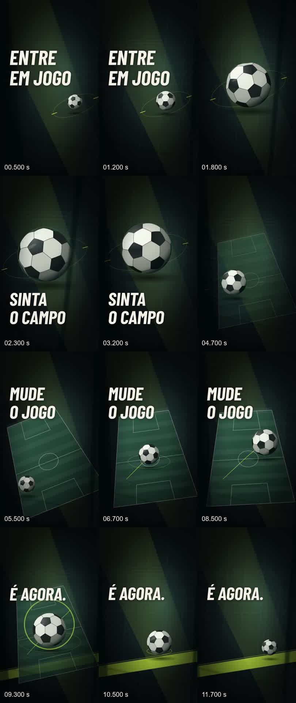
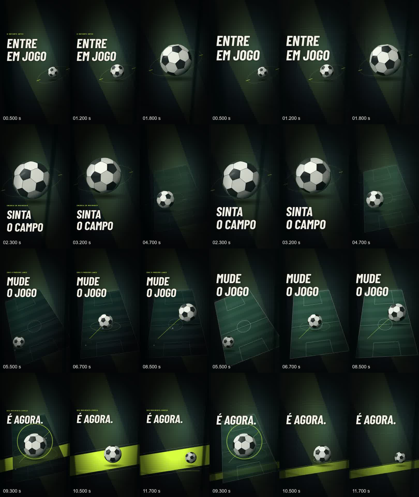

# M3.2 — V2 Broadcast: polimento final e arquitetura proposta do M4

Data: 26/10/2026. **M3.2 implementado e renderizado; aprovação artística humana pendente.**
M4 foi somente documentado no [ADR](M4_MOTION_COMPOSITION_ENGINE_ADR.md).

## 1. Base real e escopo

Repositório existente disksanluca/mediagrid; PR #45 é a base M3, branch
codex/creative-m3-motion-proof, SHA a89564e97cfea8373cfa0d954196354db0df54ef.
A branch codex/creative-m3-1-art-refinement foi localizada e preservada localmente
no commit 3c5ffe5. Não havia branch M3.1 no remoto na auditoria inicial.

Esta rodada usa codex/creative-m3-2-final-polish, descendente da M3.1.
O único PR draft desta entrega inclui a dependência M3.1 ainda local e o delta M3.2,
com base na branch M3 do PR #45. Não cria PRs intermediários nem faz merge.
O projeto trAIde indicado no cwd da conversa não foi modificado.

O pedido seleciona V2 como direção provisória. Não concede aprovação artística ao
novo MP4. A referência Sports/Music/Geo anexada foi usada para o estudo do M4;
nenhuma imagem, marca, jogador ou música dela foi incorporada ao vídeo.

## 2. O que mudou

A nova variante explícita **broadcast_final** preserva original, editorial e broadcast.
O seletor Creative Director distingue V2 M3.1 de V2 final M3.2.

| Aspecto | V2 M3.1 | V2 final M3.2 |
|---|---|---|
| Campo | verde escuro, linhas discretas | luz local no plano, linhas mais legíveis; fundo continua escuro |
| Profundidade | vinheta e foreground mais opacos | separação aumentada entre campo, arquitetura e primeiro plano |
| Encerramento | faixa sólida larga, outra linha horizontal | faixa mais baixa/estreita com gradiente; linha extra removida |
| Títulos | kickers pequenos e máscara de entrada | texto principal maior, entrada da linha inteira; kickers só em diagnóstico |
| Marcadores | 01/02/03 pequenos na trajetória | ocultos em produção; diagnóstico preservado |
| Áudio | pulsos/noise da primeira V2 | novos timbres de corpo, contato, brilho, ar, antecipação e resolução |

O título “É AGORA.” fica no ato 9–12 s; não há saída antecipada no último ato.
A entrada termina aproximadamente em 9,3 s, reservando leitura até o final.
A tipografia usa a mesma Barlow Condensed licenciada e empacotada no M3.1
(SIL OFL 1.1, arquivo de licença existente). Nenhuma fonte externa foi adicionada.

A trajetória da bola, quatro atos 2/3/4/3 s, duração, storyboard e textos foram
mantidos. O vídeo continua gráfico/vetorial 2.5D, sem promessa de fotorrealismo.

## 3. Arquitetura preservada

O fluxo continua sendo CreativeReview vigente → derive_motion → EDL v2 derivada
imutável → preview/render_props → Job idempotente → worker Remotion/FFmpeg.
A única extensão de contrato é um literal adicional de art_direction, refletido
em Python, tipos TS, seletor e dispatch existente.

O script de prova existente ganhou --polish-broadcast. Ele copia o banco descartável
M3 com SQLite backup em mode=ro, importa o áudio original como asset OWNED e usa
as rotas de preview/render/job/download existentes. Não escreve no banco instalado.
O worker executou um job real; não foi render por um pipeline independente.

A trilha derivada é explícita no request e no manifesto, como em M3.1.
A aprovação editorial continua vinculada ao conteúdo original, enquanto áudio,
renderer, preset e configurações fazem parte do hash do plano/artefato derivado.
A aprovação do storyboard não foi reutilizada como aprovação audiovisual.

### Invariantes verificados

- Project.edl, Project.plan e Project.script iguais antes/depois.
- CreativeReview e snapshot iguais antes/depois, zero novas decisões de storyboard.
- Repetir a requisição devolveu o mesmo ID de job.
- Preview e export usaram o mesmo plano; download retornou 200 após sucesso.
- O worker revalida snapshot/dependências antes da execução e disponibilização.
- Banco M3 de origem manteve o hash; os três MP4s anteriores mantiveram seus hashes.
- Migração: nenhuma. Alembic permanece no único head 0012_creative_direction.
- Sem mudança de .env.example, locks, dependências, instalador ou dados reais.

A aprovação existente é a da **fixture sintética** M3; actor “M3 fixture operator”.
Não representa aprovação humana da estética. Os arquivos de provas anteriores
permanecem disponíveis localmente. Como o runtime_manifest M3 inclui fontes do
renderer/bridge, jobs antigos podem ser considerados obsoletos pela API após uma
mudança de código; não se removeu essa proteção. Para repetir via API, derivar um
novo job na variante antiga. Isso não modifica a aprovação do storyboard.

## 4. Arquivo final e evidência técnica

MP4 local, não publicado e não versionado no Git:

    C:\Users\SP0097A\Documents\Codex\2026-10-12\github-plugin-github-openai-curated-remote-2\work\mediagrid\data\creative-m3-2-proof\final-01\v2\mediagrid-v2-broadcast-final.mp4

| Campo | Resultado |
|---|---|
| Job | 0032b4b9-b5af-5fc7-9791-11d73142f083 |
| Estado | SUCCEEDED |
| Vídeo | H.264 High, 1080×1920, 9:16, 30/1 FPS |
| Contagem | 360 frames decodificados |
| Duração vídeo | 12,000 s |
| Áudio | AAC LC, estéreo, 48.000 Hz |
| Duração áudio/container | 12,011 s |
| Tamanho | 8.066.040 bytes |
| Render + validação | 40,612 s neste host |
| Decode integral | PASS |
| Frames pretos acidentais | nenhum segmento detectado |
| Avaliação artística | AWAITING_HUMAN_REVIEW |

Tolerâncias: vídeo ±1 frame (33,333 ms), áudio/container ±60 ms por padding AAC;
offset de envelope áudio ±30 ms, medido em janelas de 10 ms.
Detecção de preto: ≥98% pixels abaixo de 2% luminância por ≥0,03 s.
Essas heurísticas não provam ausência de todo defeito artístico.

Hashes SHA-256:

| Objeto | Hash |
|---|---|
| MP4 final | 01148fca7efcb273059797b06437f8e4d553fe832165e6f940b4952270f661ec |
| Plano derivado | 93d496df5acd6951355b531518b922c35a03281bd28b6b1505196cdce3921807 |
| Storyboard | 58284939a9a0526d430fc29530c0cb7d8ae5be07f76805095acafa59b61317c7 |
| Snapshot aprovado | 1f93f337029126e955a9d84aca9552784fbf3e8c00ae85d6fcb432aa1b4d2242 |
| WAV original M3.2 | 195fbe795798a21e4cf7af34ffc4e91f756b809993cd87e6fd6d5b8b929ee539 |
| Banco M3 origem preservado | 007e266dc05d9e0f281077044a4570f67500a613ad2b81964a34e235be46f962 |

[FFprobe completo](testing/creative-m3-2/ffprobe.json),
[prova de API/worker](testing/creative-m3-2/proof.json),
[QA](testing/creative-m3-2/qa.json),
[isolamento](testing/creative-m3-2/isolation.json),
[hashes anteriores preservados](testing/creative-m3-2/preservation.json).

## 5. Relatório sonoro

Trilha original por síntese procedural stdlib, sem samples de terceiros.
Seed 3202, PCM estéreo 16-bit/48 kHz, 576.000 amostras por canal.
Osciladores/resonadores/ruído filtrado geram as seguintes funções:

- 0 s: corpo grave de abertura e ataque curto.
- Antes de 2/5/9 s: antecipações reversas e ar em movimento estéreo.
- 2 s: revelação com ressonância/brilho distinto da abertura.
- 5/6,45/7,7 s: contatos/traços acompanhando a trajetória, pan variável.
- 9 s: impacto do clímax com textura própria.
- 10,5 s: resolução harmônica e cauda, com menos subdivisões.

Densidade, timbre e posição variam; o ganho global é um escalar fixo calculado
após medida EBU R128, limitado pelo teto inicial de pico. Não há limiter.
A mistura existente usa ganho 0,9. A normalização não busca competir em volume.

| Medida no MP4 | V2 anterior | V2 final |
|---|---:|---:|
| Loudness integrado | -22,5 LUFS | -22,8 LUFS |
| True peak | -4,3 dBFS | -4,1 dBFS |
| Canais | 2 | 2 |
| Envelope fonte → AAC, 7 cues | — | 0 ms em todos, resolução 10 ms |

O RMS/pico mono em qa.json vem da análise auxiliar do script base; não substitui
o true peak estéreo medido por ebur128=peak=true. Sem clipping detectado.
O alinhamento fonte/AAC não comprova que os timbres sejam artisticamente adequados.

A repetição independente da síntese gerou o **mesmo SHA-256 do WAV** neste host:
[reprodução](testing/creative-m3-2/score-reproduction.json).
MP4 não promete identidade binária entre versões de FFmpeg/Chromium/hosts.
[Manifesto de origem/eventos](testing/creative-m3-2/score-manifest.json),
[relatório EBU R128](testing/creative-m3-2/loudness.txt).

**Escuta e aprovação artística humana: pendentes.** Não foi feita avaliação humana
em fones, alto-falante ou celular nesta execução. A entrega permite essa avaliação;
análise técnica de envelopes/LUFS não substitui ouvir o vídeo completo.

## 6. Inspeção visual e comparação

Inspeção dos frames: campo e trajetória se separam melhor do fundo, títulos ficam
inteiros nas janelas principais e a faixa final ocupa menos espaço que o título/bola.
Amostras em escala de telefone foram verificadas; não houve teste físico em smartphone.
O encerramento mantém uma pausa de leitura com movimento residual intencional.

A região fixa do campo aos 6,7 s passou de média de luminância 35,193 para 59,675
em 8 bits. Inclui bola/rota; não é nota de contraste, legibilidade ou qualidade.
A diferença média entre frames do último ato caiu de 3,38101 para 2,75883,
coerente com retirar movimento competitivo. Não se usou aumento dessa métrica
como objetivo artístico. A série completa está em
[comparison.json](testing/creative-m3-2/comparison.json).

Problemas/limites ainda relevantes para sua avaliação:

- A bola continua vetorial; não há material ou luz física 3D.
- Fundo ainda escuro por direção; brilho baixo de tela pode ocultar arquitetura.
- Safe area foi verificada nos frames, sem sobreposição de todas as UIs de redes sociais.
- O encode atual informa yuvj420p/full range e bt470bg. Consistência de cor em apps
  de publicação deve ser testada separadamente; não foi alterado o perfil do pipeline.
- A leitura inicial é curta por desenho broadcast. Avaliar o vídeo em movimento.
- Remover microtextos é uma escolha do preset final; modo diagnóstico mantém informações.
- Interação do seletor no navegador não foi testada nesta rodada. Typecheck/build/API
  passaram; não se afirma validação E2E de navegador.
- Não há reprovação/aprovação artística automática nem pontuação “cinematográfica”.

## 7. Testes executados

| Comando / operação real | Resultado |
|---|---|
| .venv/Scripts/python.exe -m pytest -q tests/test_creative_m3.py tests/test_creative_m3_1.py | 15 passed, 13,91 s |
| .venv/Scripts/python.exe -m pytest -q tests | 150 passed, 1 skipped, 168,87 s |
| .venv/Scripts/python.exe -m ruff check . | PASS |
| node node_modules/typescript/bin/tsc --noEmit -p apps/renderer/tsconfig.json | PASS |
| node node_modules/typescript/bin/tsc --noEmit -p apps/web/tsconfig.json | PASS |
| node ../../node_modules/vitest/vitest.mjs run, em apps/web | 3 passed |
| node ../../node_modules/next/dist/bin/next build, em apps/web | PASS |
| .venv/Scripts/python.exe -m alembic heads | 0012_creative_direction, único head |
| proof_creative_motion_refinement.py --polish-broadcast, preview-01 | preview real e QA base PASS |
| proof_creative_motion_refinement.py --polish-broadcast, final-01 | render final real, invariantes PASS |
| qa_creative_motion_polish.py, final-01/v2, baseline M3.1 final-02/v2 | FFprobe/decode/áudio/sync/frames/comparação PASS |
| repetição de create_score em arquivo separado | SHA WAV idêntico |
| verificação dos MP4s M3/V1/V2 e banco M3 | hashes preservados |
| verify_motion sobre o plano final persistido, após reabrir sessão isolada | snapshot, runtime e dependências continuam válidos |
| git diff --check | PASS |
| json.loads dos três exemplos do ADR | sintaxe PASS; schema M4 não implementado |

[Log Python](testing/creative-m3-2/pytest.txt).
O único skip é tests/test_narrative_3d.py::test_3d_blender_blocking_and_final_are_real:
MEDIAGRID_TEST_BLENDER não configurado para Blender 4.5 LTS. Não envolve M3.2.
Os mocks de encoder em testes são testes de orquestração; a prova MP4 acima usou
o encoder real. Testes de API cobrem idempotência, variantes, direitos, tampering,
aprovação preservada e regressões herdadas de concorrência/snapshot.
PostgreSQL não foi executado novamente nesta rodada sem schema novo.

npm não estava no PATH; binários locais Node foram invocados diretamente.
Versões preservadas: Remotion/Player 4.0.532, Node 24.19.0, Next 16.3.8,
Python 3.12.10, FFmpeg/FFprobe 9.0.2. Sem instalação de dependência nova.

## 8. Arquivos alterados no delta M3.2

| Arquivo | Alteração |
|---|---|
| apps/api/creative/motion.py | aceita broadcast_final no contrato fechado |
| apps/api/edl_v2.py | variante no SportsCinematicSpec |
| apps/renderer/src/types.ts | tipo da variante |
| apps/renderer/src/sports-refinement.tsx | luz local, títulos, diagnóstico, faixa final |
| apps/web/lib/types.ts | tipo correspondente no cliente |
| apps/web/components/creative/creative-motion-proof.tsx | seleção explícita da nova versão |
| scripts/m3_2_score.py | síntese original e manifesto |
| scripts/proof_creative_motion_refinement.py | flag M3.2, diretório isolado, prova existente reutilizada |
| scripts/qa_creative_motion_polish.py | QA/comparação real com V2 preservada |
| tests/test_creative_m3_1.py | nova variante no teste de identidade/idempotência/preservação |
| docs/CREATIVE_M3_2_FINAL_POLISH.md | este relatório |
| docs/M4_MOTION_COMPOSITION_ENGINE_ADR.md | estudo documental do motor, sem código M4 |
| docs/testing/creative-m3-2/* | evidências compactas; MP4/WAV/banco ficam locais em data/ |

O PR também carrega o delta M3.1 previamente local, descrito separadamente em
[CREATIVE_M3_1_ART_REFINEMENT.md](CREATIVE_M3_1_ART_REFINEMENT.md).

## 9. Reproduzir e verificar

Na raiz do repositório, com Python/Node/FFmpeg/FFprobe/Chromium locais já configurados:

    .venv/Scripts/python.exe scripts/proof_creative_motion_refinement.py --source data/creative-m3-proof/final-01 --run minha-v2-final --quality final --polish-broadcast
    .venv/Scripts/python.exe scripts/qa_creative_motion_polish.py data/creative-m3-2-proof/minha-v2-final/v2 --baseline data/creative-m3-1-proof/final-02/v2

Usar um nome novo: o script recusa substituir uma pasta existente e limita source
à área descartável M3. O banco instalado nunca deve ser fornecido ao script.
Em clone sem data/, reproduzir primeiro a fixture do
[relatório M3](CREATIVE_M3_MOTION_PROOF.md), depois a baseline do
[relatório M3.1](CREATIVE_M3_1_ART_REFINEMENT.md). IDs/hashes do plano podem variar
com fixture/runtime; comparar a linhagem, não exigir os UUIDs desta máquina.

Os manifests, WAV, preview.json e derived-plan.json ficam junto ao MP4.
O banco descartável está em data/creative-m3-2-proof/final-01/workspace.db.
O arquivo final pode ser aberto diretamente em um player local; não depende de servidor.

Integrações: API/SQLite/worker/Remotion/FFmpeg **REAL**; mídia **sintética original
declarada**. M4 **PROPOSTO/PAPER**, sem endpoint ou motor entregue.
Zero chamadas pagas/deploy/publicação. Energia e custo de hardware não medidos.

## 10. Próximo passo

Assistir e ouvir a V2 final, comparar com a V2 anterior e registrar sua avaliação.
O [ADR M4](M4_MOTION_COMPOSITION_ENGINE_ADR.md) propõe contratos, primitivas,
três receitas diferentes, integração EDL, limites, revisão por artefato e gates.
A implementação do M4 não foi iniciada. Esta entrega termina aguardando avaliação humana.
