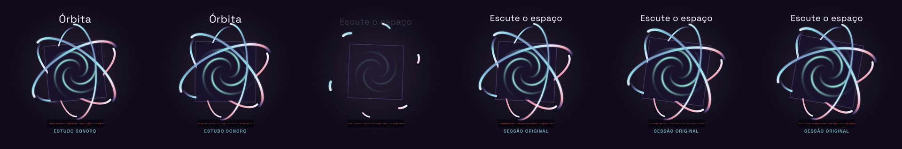

# M4 — Motion Composition Engine v1: entrega consolidada B/C/D

Data: 26/10/2026. Branch única: `codex/m4-complete-motion-engine`.
[PR draft #48](https://github.com/disksanluca/mediagrid/pull/48), baseado no PR #47
(`2b96b896807c8aa33fcc64053a17e11ba0114dd3`). O HEAD remoto conferido no início
desta revisão foi `e47a549633fcbb64f89e936e84db6b04ebeb0b0b`; a cadeia foi preservada.

**Entrega atual: receitas 1.2.0, três MP4s originais e reais, pelo mesmo compilador,
interpretador, EDL v2 e worker. Avaliação artística humana pendente.**
As provas atuais estão em `data/m4-complete-proof/m4d-final-03/`.
Versões 1.0/1.1, provas anteriores e M3/M3.1/M3.2 permanecem preservados.
Os quatro hashes anteriores foram novamente conferidos:
[preservação](testing/m4-complete/preservation.json).

Nenhum merge, instalação no PC principal, acesso ao SQLite instalado, VPS,
publicação, serviço pago ou implementação do Scout. Banco, projetos e assets
desta prova são descartáveis. A aprovação dos storyboards identifica explicitamente
fixtures sintéticas; cada MP4 permanece em REQUEST_REVIEW.

## Arquitetura

```text
Brief + DNA + direção + storyboard aprovado + receita + assets licenciados
  → validação contextual / direitos / claims / hashes físicos
  → receita expandida para os tempos aprovados
  → MotionComposition + MotionSceneSpec resolvido
  → EDL v2 derivada (motion_scene_v1 + sound_v1)
  → plano imutável no Job CREATIVE_MOTION
  → MediaGridTimelineV2 / MotionSceneRenderer
       ├─ Player React, URLs da biblioteca
       └─ worker existente, staging + Remotion + FFmpeg
  → MP4 + FFprobe + SHA-256
  → revisão humana append-only do artefato exato
```

Reutilizados: Channel/Project/ProjectRevision, Creative M1/M2, EDL v2,
direitos/claims, fila CREATIVE_MOTION, idempotência UUIDv5, staging/mixer,
lease/heartbeat/fencing, cancelamento/retry, Remotion/FFmpeg, Player e tokens Atelier.
Não há segunda timeline nem renderizador paralelo.

Duração e ordem vêm dos shots aprovados. A receita é ajustada deterministicamente
e validada novamente em frames absolutos. O compilador não escreve
`Project.edl`, `Project.plan` ou `Project.script`. O plano registra briefing,
DNA, direção, storyboard, aprovação, receita original/expandida, assets/proveniência,
EDL derivada, configurações, dependências e hashes.

O worker verifica novamente snapshot, fontes, receita, runtime e arquivos antes
e depois da codificação. Alterações bloqueiam o artefato. O histórico de revisão
continua consultável em estado STALE; decisões novas/download exigem validade atual.

## Contratos, segurança e determinismo

- M4.A preservado. Adicionados `MotionSceneSpec` e `EngineRequest`, JSON Schema e
  TypeScript derivados por `scripts/generate_motion_contracts.py`.
- `mg-canonical-json-v1`; hashes da receita registrada, instância, composição,
  plano, dependências, MP4 e decisão. Hashes do renderer/bridge/worker/contratos,
  pacotes instalados e licença da fonte ficam no plano.
- URLs/caminhos de mídia são acrescentados pelo runtime confiável. Props recebem
  uma cópia profunda da EDL; preparar preview não muda o plano aprovado.
- JSON até 2 MiB, profundidade 24; 3–30 s, 30 FPS e três canvases; até 128 nodes
  por cena/512 no conjunto, hierarquia 6 níveis, 4096 vértices, 8192 keyframes,
  64 cues e limites simultâneos de mídia/efeitos.
- Assets registrados sob a raiz da biblioteca, sem symlink, SHA-256 físico,
  até 128 MiB por asset, direitos comerciais, presença no brief e nos shots.
  Validação de MIME/codec, duração, dimensões e trim.
- Não são aceitos código JS, CSS, shaders, URLs ou caminhos arbitrários em receitas.
  A edição livre de EDL rejeita `motion_scene_v1`; esse preset é derivado somente
  pelo fluxo aprovado.
- Fontes incorporadas: Barlow Condensed Bold, Space Grotesk Regular e IBM Plex Sans Regular, OFL-1.1. Medição de avanços
  da TTF, wrapping, limite de linhas e rejeição de glifos ausentes/overflow.
  Sem fallback silencioso.
- 409 para revisão/snapshot obsoleto; 422 para contrato/binding inválido.
  Aprovação artística exige confirmação de vídeo, áudio e direitos.
- A autenticação administrativa/local existente é preservada; não foi criado
  um sistema de contas multiusuário ou de publicação.

## Primitivas

Um único componente React interpreta todas as receitas:

| Primitiva | Implementação |
|---|---|
| Grupos | Hierarquia, transformação/opacity herdadas, ordem e intervalos |
| Texto | TTF incorporada, linhas medidas, alinhamento, animações e máscaras |
| Shapes | Retângulo, elipse, polígono, polyline; fill/stroke/draw_progress/gradientes |
| Transformação | XYZ, escala XY, rotação Z e opacity |
| Câmera | Perspectiva 2.5D, posição/rotação/focal e parallax |
| Keyframes | Frames absolutos; linear, hold, cubic e Bezier; referências a cues |
| Máscara | Clip SVG de grupo irmão, geometria e abertura animável |
| Trajetória | Comprimento de polyline, marcador e transformação herdada |
| Imagem/vídeo | Biblioteca; Img/OffthreadVideo, contain/cover, trim, vídeo mudo |
| Efeitos | Partículas por seed; light sweep e glow limitados |
| Áudio | sound_v1 existente, source trim, gain, fades e cues sincronizados |

É 2.5D, sem malhas/volumes/physics/PBR/depth buffer. Grupos exigem anchor [0,0].
`fade_slide` identifica a família tipográfica; movimentos são keyframes explícitos.
Transições são dados, sem componentes React exclusivos para cada vídeo.


## API e UI

Prefixo `/api/v1`:

| Método/rota | Efeito |
|---|---|
| GET /creative/motion/recipes | Catálogo e capacidades verificadas |
| POST /projects/{id}/creative/motion/engine/preview | Plano/hash/props derivados dos inputs aprovados |
| POST /projects/{id}/creative/motion/engine/render | Job idempotente, 202, fila existente |
| GET /projects/{id}/creative/motion/jobs/{job}/video | MP4 com hash/dependências vigentes |
| GET /projects/{id}/creative/motion/jobs/{job}/review | Status, revisão, blockers, histórico |
| POST /projects/{id}/creative/motion/jobs/{job}/review | REQUEST_REVIEW / APPROVE / REJECT |

Creative Director → Revisão → Direção audiovisual: receita versionada,
escala de texto, ganho, diagnóstico opcional, resolução, assets autorizados do brief,
Player real, render, progresso/erros/cancelamento de espera/retry, comparação de
até dois resultados, download e revisão. Mudanças de parâmetros invalidam a prévia.
M3/M3.1/M3.2 continuam disponíveis no painel original.

`JobRead.motion_schema` projeta o tipo do payload sem nova coluna e evita rotular
jobs M4 como renders M3. O Studio/editor legado continuam representando a EDL
original; artefatos derivados são acessados pelo Creative Director.
Aprovar um artefato nunca ativa publicação.

## Migração e restauração

Head antes da integração M4.C: 0012_creative_direction. Head vigente, sem nova migração no polimento M4.D:
**0013_motion_artifact_review**.

A tabela motion_artifact_reviews guarda projeto/job, revisão da decisão,
hashes do plano/vídeo/snapshot/dependências, decisão, ator da sessão, notas e data.
Unicidade (job,revision) e (job,request hash) para concorrência/idempotência.
Não contém timeline. O downgrade recusa apagar histórico existente.
O ator não é um campo livre do cliente.

Testados upgrade 0012→0013, downgrade vazio, bloqueio com revisão persistida,
preservação de projeto legado e .mgrid backup/restore em diretórios temporários.
O backup existente agora inclui **creative-renders**.
PostgreSQL 16: smoke ampliado para migrações/lease e dump/restore de revisão.
SQLite instalado do usuário não foi aberto ou alterado.

## Receitas 1.2.0 e generalização

| Prova | Estrutura e direção | Tipografia / áudio |
|---|---|---|
| Sports · 12 s · 1080×1920 | 4 shots (2/3/4/3 s), campo em perspectiva, bola com painéis/gradientes/sombra, faixas próximas, máscaras, trajetória e clímax | Barlow Condensed Bold; percussão, antecipações e impactos em 0/2/5/9 s |
| Music · 10 s · 1080×1080 | 2 shots (4/6 s), capa PNG original, três órbitas com trechos dianteiros/traseiros, gradientes, revelação e waveform original | Space Grotesk Regular; acorde/arpejo original, mudança em 4 s e resolução final |
| Geo · 15 s · 1920×1080 | 3 shots (5/5/5 s), 80 triângulos de relevo ficcional, rio, rota contínua, marcadores e câmera acompanhando o percurso | IBM Plex Sans Regular; ambiente harmônico e sinais de localização em 0/5/10 s |

O JSON contém a composição específica. `MotionSceneRenderer`, `motion-evaluate`,
`MediaGridTimelineV2`, compilador e fila são compartilhados. Não há componentes
SportsVideo/MusicVideo/GeoVideo. `motion_recipes_v12.py` apenas produz dados JSON;
não renderiza nem funciona como outra timeline.

Extensões fechadas: gradientes linear/radial, 2–8 stops ordenados da paleta DNA,
glow 0–16 px com até oito nodes por cena, tracking -4..24 px e `line_index`
0..5 para selecionar uma linha exata do texto aprovado. Nenhum texto factual é
reescrito. Defaults novos são omitidos na serialização, preservando hashes antigos.
Os tipos TS e JSON Schemas continuam derivados do Pydantic.





## Fontes, assets e direitos

Scores, capa, waveform, geometria da bola e mapa são materiais procedurais originais,
registrados na biblioteca como OWNED/CC0-1.0, com SHA, MIME, dimensões/duração
e direitos comerciais verificados. Vale Aurora e Norte Luminar são ficcionais.
As imagens de referência do pedido não foram incorporadas aos filmes.

Fontes locais OFL-1.1, sem download durante render:
Barlow Condensed Bold existente; Space Grotesk Regular e IBM Plex Sans Regular.
[Manifesto com commits, SHA e origens](../apps/renderer/src/motion-font-provenance.json).
Space Grotesk foi fixada no commit `03507d024a01282884232081fc6011c09ff4e849`;
IBM Plex no `71f558992315a12ca1f06a2215d57962a1992162`.
Fontes e licenças acompanham o runtime desktop. Não houve atualização de dependências.

Fontes oficiais verificadas:
[Space Grotesk](https://github.com/floriankarsten/space-grotesk),
[IBM Plex](https://github.com/IBM/plex),
[Remotion renderMedia / colorSpace](https://www.remotion.dev/docs/renderer/render-media).
O utilitário `vendor_motion_fonts.py` é de autoria explícita; não é chamado pelo aplicativo.

## Validação executada

| Comando / gate | Resultado |
|---|---|
| `.venv/Scripts/python.exe -m pytest -q tests` | 274 passed, 1 skipped, 156,32 s |
| `pytest tests/test_render_logging.py tests/test_creative_m3.py tests/test_motion_engine.py -q` após correção Windows | 36 passed, 34,03 s |
| `.venv/Scripts/python.exe -m ruff check .` | PASS |
| `python scripts/generate_motion_contracts.py --check` | PASS |
| `python scripts/build_motion_recipes.py --check` | PASS |
| `node node_modules/typescript/lib/tsc.js --noEmit -p apps/web/tsconfig.json` | PASS |
| Mesmo typecheck em apps/renderer e contracts/motion | PASS |
| `node node_modules/vitest/vitest.mjs run --root apps/web` | 11 passed |
| `node node_modules/next/dist/bin/next build apps/web` | PASS |
| `proof_motion_engine.py --run m4d-final-03 --concurrency 2 --approve-synthetic-storyboards` | 3 jobs reais SUCCEEDED; projetos/EDL/aprovação originais preservados |
| `qa_motion_engine.py` nas três pastas | Decode integral de 1110 frames + áudio; FFprobe, cor, loudness, sync e blackdetect |
| `repeat_motion_engine.py .../m4d-final-03/sports` | Mesmo plano, concorrência 1; comparação com concorrência 2 |
| `node scripts/qa_motion_player.mjs data/m4-complete-proof/m4d-final-03` | Player real, seek reverso, screenshots, SSIM, safe areas e benchmark |

O skip é o runtime Blender 4.5 LTS opcional não configurado; não é necessário a M4.
`npm` não estava no PATH local; os entrypoints Node instalados foram executados
diretamente. Uma tentativa de usar o antigo caminho `handoff/reference/python/tests`
constatou que essa pasta não existe neste checkout; nenhum teste inexistente é contado.

Cobertura: API, concorrência, restart, invalidação de revisão/hashes, EDL legada,
migração/restore isolados, direitos, fontes, texto, gradientes inválidos/limites,
receitas antigas, geometria, câmera, easing e seeks. Mocks de artefato existem apenas
em testes unitários de gates; os MP4s desta entrega usam render real.

### CI Windows e PostgreSQL

O HEAD inicial e47a549 tinha checks verdes: Windows 40287667811, PostgreSQL
40287667796 e contratos 40287667788. Esses resultados históricos não certificam
o código alterado. Os checks do novo HEAD e seus resultados estão vinculados ao
[PR #48](https://github.com/disksanluca/mediagrid/pull/48/checks), também registrados
na entrega final. O smoke instalado no runner agora usa Sports 1.2.0, serviço e
worker empacotados, MP4 H.264/AAC real e revisão pendente. O smoke PostgreSQL 16
verifica migrações, lease e dump/restore. Nada disso instala o app no PC principal.

### Falha detectada no Windows instalado e correção

O run [40298038087](https://github.com/disksanluca/mediagrid/actions/runs/40298038087)
do commit 642a88f passou 274 testes Python (1 skip), compilou e instalou o app,
mas o render M4 falhou com `'charmap' codec can't encode characters`.
O novo encaminhamento de logs do CLI escrevia glifos Unicode em stdout cp1252.
`write_render_log` agora adapta somente o texto do log à codificação do stream;
comandos, props, mídia e gates permanecem intactos. Processo sem console é suportado.
Três casos novos verificam cp1252, UTF-8 e stdout ausente; a regressão M3/M4 com
36 testes passou. O primeiro caso UTF-8 do teste precisou explicitar newline para
separar codificação da conversão CRLF do Windows.

As provas foram regeneradas em m4d-final-03 com o novo hash de worker, incluindo
QA e repetição do render. A nova CI do commit de correção deve ser conferida nos
checks do PR; o run falho permanece registrado e não foi reclassificado como sucesso.

## Critérios técnicos e limitações de medição

- H.264/yuv420p, AAC estéreo 48 kHz, 30 FPS. Tolerância: um frame de vídeo;
  60 ms de áudio/container por padding AAC.
- BT.709 em primárias, transferência e matriz; range limitado `tv`.
  O M4 usa PNG intermediário e `--color-space=bt709`. O default dos renders M3
  permanece preservado.
- Loudness medido com FFmpeg loudnorm (análise, saída descartada):
  faixa de prova -24..-12 LUFS e true peak ≤-1 dBTP. Não é masterização universal
  para todas as plataformas. Peak/RMS são calculados no estéreo; sync usa mono.
- Blackdetect: 98% dos pixels abaixo de 2%, intervalo mínimo 30 ms.
  Texto: métricas TTF no compilador e bounds reais do navegador em todos os frames
  com opacidade >0,98. Revelações por máscara são intencionais.
- Sync: correlação de janelas com o WAV autoral após cada cue, busca ±10 ms em
  passos de 1/48000 s; não mede musicalidade nem intenção sonora.
- Paridade Player/export: frames de leitura, meio e fim de cada shot a 50%;
  SSIM ≥0,96 contra PNG extraído do MP4, incluindo diferenças H.264/BT.709/escala.
  Não é uma afirmação de identidade de pixels em todos os frames.
- Seek fora de ordem: mesmo SVG; tolerância de rasterização Chromium de máximo
  2/255 e erro médio ≤0,2/255 por canal. O relatório registra também hashes PNG
  e fração de canais alterados. Captura aguarda estabilidade do compositor.
- Repetição de render: PSNR mínimo ≥50 dB e PCM idêntico. MP4 não precisa ter
  o mesmo SHA entre concorrências; o hash sempre identifica o arquivo concreto.

### Problemas encontrados e corrigidos nesta rodada

Music tinha sobreposição orbital e título 6 px acima da safe area; a geometria e
a posição foram ajustadas. Sports inicialmente mediu -27,43 LUFS; o ganho do score
original foi calibrado mantendo headroom e a hierarquia dinâmica.
A comparação por seek detectou cache SVG obsoleto de gradientes no primeiro salto
de Music, apesar do DOM idêntico. O interpretador agora recria somente folhas de
material e seus defs por frame, preservando a identidade dos elementos de mídia.
A comparação real foi repetida após a correção, e os três MP4s foram regenerados.

## Avaliação artística

Frames foram inspecionados. Sports usa volume vetorial e hierarquia forte;
Music usa capa abstrata e órbitas em camadas; Geo usa relevo ficcional e percurso
progressivo. As três estruturas e fontes são diferentes.

Limites visuais: bola estilizada sem fotorealismo/PBR; órbitas são projeções vetoriais,
sem oclusão 3D física; a pequena faixa de waveform tem fundo visível; o terreno Geo
é facetado e demonstrativo, sem cartografia real. As transições e a sofisticação
audiovisual ainda dependem do julgamento humano, inclusive comparação com M3.2.
Não foi realizada escuta humana pelo agente. Musicalidade, timbres, ritmo e
adequação editorial permanecem para avaliação do usuário. Movimento de pixels
e SSIM não aprovam artisticamente os filmes.

## Arquivos finais, hashes e QA

[Evidência completa: planos, assets, FFprobe e métricas](testing/m4-complete/m4d-evidence.json).

| Vídeo | Resolução | Frames | LUFS / dBTP | SSIM mínimo Player/export |
|---|---|---:|---:|---:|
| sports | 1080×1920 | 360 | -23.35 / -3.59 | 0.968732 |
| music | 1080×1080 | 300 | -21.25 / -8.15 | 0.981709 |
| geo | 1920×1080 | 450 | -22.32 / -10.63 | 0.984659 |

Zero intervalos pretos e zero overflow observado nas checagens de texto dos 1110 frames.
Defasagem medida: -0,333 ms no primeiro cue e 0 ms nos demais; correlação mínima 0.999977.

- **sports**: [abrir MP4](<C:/Users/SP0097A/Documents/Codex/2026-10-12/github-plugin-github-openai-curated-remote-2/work/mediagrid/data/m4-complete-proof/m4d-final-03/sports/sports-motion.mp4>)
  - SHA-256: `5cfafd87b267b0280b89664a767246bb0df967c268d0db103356a4abf8523f9c`
  - Plano: `bcf2bbcfea537018b96d6737a74032c11789f83d9c6f179d0c26c34fc920821e`
  - Receita: `718bc8a8bfcae4085a99c380dd26f7f0c314a32587f1fbf57a9cf3b3403edb4c`
- **music**: [abrir MP4](<C:/Users/SP0097A/Documents/Codex/2026-10-12/github-plugin-github-openai-curated-remote-2/work/mediagrid/data/m4-complete-proof/m4d-final-03/music/music-motion.mp4>)
  - SHA-256: `d377d11f7575b36e135cf8355863e19526e9db5c47232ac356254d4bee297f19`
  - Plano: `a721c413b1dfcdba33019a384eedd33af5e3ef553fbebab74d988f76b661b922`
  - Receita: `c2504f99ffbc5972f348bf2ea7e0b115153e8c2d41a410a142216818883f0caf`
- **geo**: [abrir MP4](<C:/Users/SP0097A/Documents/Codex/2026-10-12/github-plugin-github-openai-curated-remote-2/work/mediagrid/data/m4-complete-proof/m4d-final-03/geo/geo-motion.mp4>)
  - SHA-256: `c528c00047441b624665aa4e26eb0ebc23e10aae5cde65a85364acca183b94c9`
  - Plano: `5c5c7c59615704d1fb5e2f3629b24a3060e922541eb67fa6d08f9cea81232f0a`
  - Receita: `795925370900dce5f8cb5428cbad056afb648304bae906227ac776fe5e9161ac`

Cada pasta contém score, mídia original, preview, plano imutável, prova do job,
FFprobe, loudness, QA, performance, frames e player-qa. Arquivos pesados são locais/ignorados;
um clone novo não os contém. Os scripts reproduzem as provas em novo diretório.

## Performance medida e metas do ADR

Windows, Intel i7-13650HX (20 processadores lógicos), 31,7 GiB RAM; RTX 4050 disponível.
Node 24.19.0, Python 3.12.10, Remotion/Player 4.0.532, React 19.3.0,
Next 16.3.8 e FFmpeg/FFprobe 9.0.2. Nenhuma exigência de WebGL ou GPU dedicada.
O perfil mínimo de 4 núcleos/8 threads/16 GiB sem GPU dedicada não foi ensaiado.

| Prova | Render s / duração | CPU observado s | Pico working set MiB | CLI→primeiro frame s | Preview FPS / pico MiB | Browser→Player pronto s |
|---|---:|---:|---:|---:|---:|---:|
| sports | 40.55 / 3.38× | 104.89 | 1805.43 | 3.27 | 29.90 / 516.71 | 0.86 |
| music | 24.68 / 2.47× | 50.06 | 1689.70 | 3.04 | 29.89 / 498.31 | 1.79 |
| geo | 41.78 / 2.79× | 150.03 | 1812.23 | 3.01 | 29.90 / 480.05 | 1.75 |

As três provas atenderam, **neste host**, export ≤10× duração, working set ≤4 GiB
e preview ≥24 FPS por 10 s após warm-up de 1,5 s. Preview medido em 540×960,
540×540 e 960×540, pelo Player real, com eventos de frames (não apenas RAF).
Amostragem Windows: 500 ms mais latência CIM; soma de working sets pode contar
páginas compartilhadas duas vezes. CPU é delta entre primeira/última observação;
processos muito curtos/picos podem escapar. Não mede VRAM. Outros aplicativos
estavam abertos; renders e benchmark do Player foram executados sequencialmente.

Cold start aqui significa **novo processo CLI/browser até primeiro frame**, ou
novo browser até o Player pronto; caches de sistema/bundler podem estar quentes.
O startup CLI inclui bundle, fontes e preparação. Não é um reboot com cache de disco vazio.

Sports repetido em concurrency=1: 56.88 s; PSNR médio 61.010467 dB,
mínimo 53.774813 dB e PCM idêntico. SHA diferente, conforme a tolerância documentada.

## Executar e verificar

Na raiz do repositório, usando o runtime local já preparado:

```powershell
.venv/Scripts/python.exe scripts/proof_motion_engine.py --run nova-prova --recipe-version 1.2.0 --concurrency 2 --approve-synthetic-storyboards
.venv/Scripts/python.exe scripts/qa_motion_engine.py data/m4-complete-proof/nova-prova/sports data/m4-complete-proof/nova-prova/music data/m4-complete-proof/nova-prova/geo
.venv/Scripts/python.exe scripts/repeat_motion_engine.py data/m4-complete-proof/nova-prova/sports
node scripts/qa_motion_player.mjs data/m4-complete-proof/nova-prova
```

O diretório precisa ser novo e interno a data/m4-complete-proof. O script define
DB e dados isolados antes de importar o backend. A flag aprova exclusivamente os
storyboards sintéticos. Render e revisão do projeto real seguem seus gates normais.
A API e o worker devem usar o mesmo banco ao testar pela interface.
Nenhuma variável nova: .env.example mantém caminhos do runtime e concorrência;
as fontes são locais e as opções de material pertencem aos contratos.

A QA do Player usa o navegador headless do Remotion e um servidor temporário
restrito a loopback/arquivos registrados; não controla o navegador pessoal.
Seu acesso CDP está acoplado ao Remotion 4.0.532 instalado e deve ser revalidado
numa atualização dessa dependência.

A interação completa da UI já havia sido exercitada no build cc773bc:
preview, reprodução, enfileiramento real, comparação e solicitação de revisão.
As capturas [Player](testing/m4-complete/player-production.png) e
[revisão](testing/m4-complete/artifact-review-production.png) são evidências históricas
dessa sessão. Nesta revisão foram testados o Player/composição atuais, API e tipos;
não se apresenta aquela captura como screenshot da nova execução.

## Arquivos alterados e decisões

| Área | Arquivos principais |
|---|---|
| Compilador e revisão | apps/api/creative/engine.py, artifacts.py, motion.py; routes/creative.py |
| Contratos | motion_contracts/models.py, validation.py, render.py, requests.py, fonts.py; contracts/motion/generated |
| EDL e banco | edl_v2.py; routes/projects.py; models.py; schemas.py; backup.py; migrations/versions/0013_motion_artifact_review.py |
| Interpretador | apps/renderer/src/motion-scene.tsx, motion-evaluate.ts, timeline-v2.tsx, types.ts, motion-fonts.tsx |
| Fontes | space-font.ts, plex-font.ts, respectivos OFL.txt e motion-font-provenance.json |
| Interface | creative-motion-engine.tsx, creative-workspace.tsx, creative-motion-proof.tsx; api.ts, motion-types.ts, types.ts |
| Receitas | contracts/motion/recipes/*.1.1.0.json, *.1.2.0.json, index.json; build_motion_recipes.py, motion_recipes_v12.py |
| Worker | creative_motion.py, remotion_runtime.py |
| Provas e QA | proof_motion_engine.py, repeat_motion_engine.py, qa_motion_engine.py, qa_motion_player.mjs, motion-player-harness.tsx, motion_engine_media.py, measure-motion-process.ps1 |
| Desktop / CI | build-desktop-sidecar.ps1, smoke_installed_motion.py, smoke-desktop-windows.ps1, smoke_postgres_migrations.py, verify_postgres_restore.py, motion-contracts.yml |
| Testes | test_motion_engine.py, test_motion_contracts.py, test_motion_m4d.py, test_render_logging.py, test_motion_migration.py, test_migrations.py, motion-engine.test.tsx |
| Documentação | este relatório, ADR M4, contracts/motion/README.md, docs/testing/m4-complete |

A tabela cobre a entrega consolidada desde PR #47; nem todos esses arquivos foram
alterados novamente no polimento 1.2.0. O diff do PR é a lista completa revisável.

| Integração | Estado |
|---|---|
| FastAPI / SQLite / biblioteca / fila / revisão | REAL, banco descartável nesta prova |
| Remotion / Player / FFmpeg / áudio sintetizado | REAL, três MP4s verificáveis |
| PostgreSQL / desktop empacotado | Gates reais na CI, resultados nos checks do PR |
| Fixtures unitárias de gates | MOCK explícito, não usado para produzir os filmes |
| Visual Reference Scout / descoberta web / VLM | PAPER, somente roadmap no ADR |
| Publicação / API paga / VPS / Lovable | Não ativados nesta entrega |

Nenhuma API paga foi consumida. CPU/RAM/tempo foram medidos; consumo elétrico
e custo de energia não foram medidos. Não há VPS obrigatório para estas provas.
O host mínimo sem GPU dedicada ainda precisa de benchmark próprio.

**Próximo passo: avaliação artística humana dos três vídeos.** Não avançar
automaticamente ao Scout, publicação, instalação principal ou novas integrações.
