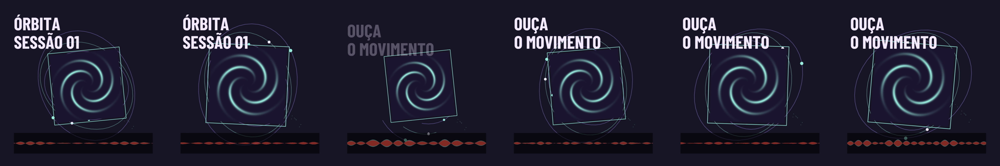
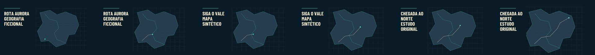
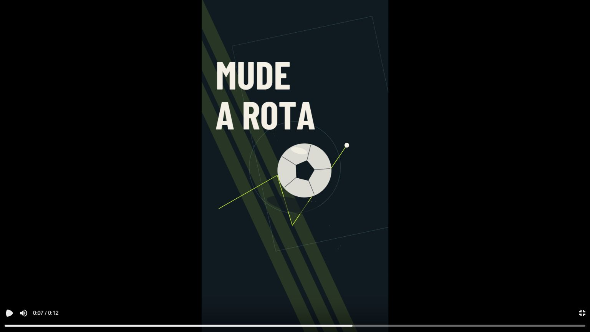
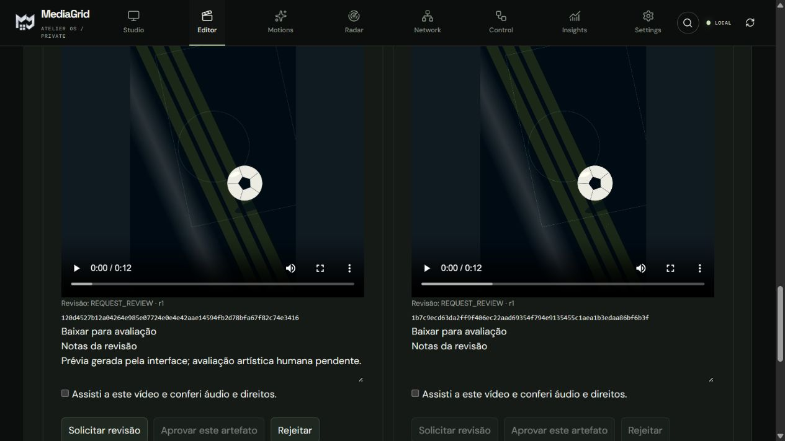

# M4 — Motion Composition Engine v1

## Entrega e base

Branch: `codex/m4-complete-motion-engine`. Base M4.A: PR #47,
`2b96b896807c8aa33fcc64053a17e11ba0114dd3`, descendente do PR #46.
M3/M3.1/M3.2 e seus quatro MP4s anteriores foram preservados por hash:
[preservação](testing/m4-complete/preservation.json).

**Entrega integrada:** três receitas diferentes, compilador, interpretador React,
Player, worker existente, revisão de artefatos e três vídeos reais.
Os storyboards sintéticos receberam aprovação explícita de fixture; os MP4s
continuam **REQUEST_REVIEW / avaliação artística humana pendente**.

Não houve merge, instalação no PC, escrita no SQLite instalado, VPS, publicação,
API paga ou implementação do Reference Scout. Os vídeos e bancos descartáveis
ficam em `data/m4-complete-proof/final/`, ignorados pelo Git.

## Arquitetura

```text
Brief + DNA + direção + storyboard aprovado + receita + assets licenciados
  → validação contextual / direitos / claims / hashes físicos
  → receita expandida para os tempos aprovados
  → MotionComposition + MotionSceneSpec resolvido
  → EDL v2 derivada (motion_scene_v1 + sound_v1)
  → plano imutável no Job CREATIVE_MOTION
  → MediaGridTimelineV2 / MotionSceneRenderer
       ├─ Player React, URLs da biblioteca
       └─ worker existente, staging + Remotion + FFmpeg
  → MP4 + FFprobe + SHA-256
  → revisão humana append-only do artefato exato
```

Reutilizados: Channel/Project/ProjectRevision, Creative M1/M2, EDL v2,
direitos/claims, fila CREATIVE_MOTION, idempotência UUIDv5, staging/mixer,
lease/heartbeat/fencing, cancelamento/retry, Remotion/FFmpeg, Player e tokens Atelier.
Não há segunda timeline nem renderizador paralelo.

Duração e ordem vêm dos shots aprovados. A receita é ajustada deterministicamente
e validada novamente em frames absolutos. O compilador não escreve
`Project.edl`, `Project.plan` ou `Project.script`. O plano registra briefing,
DNA, direção, storyboard, aprovação, receita original/expandida, assets/proveniência,
EDL derivada, configurações, dependências e hashes.

O worker verifica novamente snapshot, fontes, receita, runtime e arquivos antes
e depois da codificação. Alterações bloqueiam o artefato. O histórico de revisão
continua consultável em estado STALE; decisões novas/download exigem validade atual.

## Contratos, segurança e determinismo

- M4.A preservado. Adicionados `MotionSceneSpec` e `EngineRequest`, JSON Schema e
  TypeScript derivados por `scripts/generate_motion_contracts.py`.
- `mg-canonical-json-v1`; hashes da receita registrada, instância, composição,
  plano, dependências, MP4 e decisão. Hashes do renderer/bridge/worker/contratos,
  pacotes instalados e licença da fonte ficam no plano.
- URLs/caminhos de mídia são acrescentados pelo runtime confiável. Props recebem
  uma cópia profunda da EDL; preparar preview não muda o plano aprovado.
- JSON até 2 MiB, profundidade 24; 3–30 s, 30 FPS e três canvases; até 128 nodes
  por cena/512 no conjunto, hierarquia 6 níveis, 4096 vértices, 8192 keyframes,
  64 cues e limites simultâneos de mídia/efeitos.
- Assets registrados sob a raiz da biblioteca, sem symlink, SHA-256 físico,
  até 128 MiB por asset, direitos comerciais, presença no brief e nos shots.
  Validação de MIME/codec, duração, dimensões e trim.
- Não são aceitos código JS, CSS, shaders, URLs ou caminhos arbitrários em receitas.
  A edição livre de EDL rejeita `motion_scene_v1`; esse preset é derivado somente
  pelo fluxo aprovado.
- Fonte inicial: Barlow Condensed Bold incorporada, OFL-1.1. Medição de avanços
  da TTF, wrapping, limite de linhas e rejeição de glifos ausentes/overflow.
  Sem fallback silencioso.
- 409 para revisão/snapshot obsoleto; 422 para contrato/binding inválido.
  Aprovação artística exige confirmação de vídeo, áudio e direitos.
- A autenticação administrativa/local existente é preservada; não foi criado
  um sistema de contas multiusuário ou de publicação.

## Primitivas

Um único componente React interpreta todas as receitas:

| Primitiva | Implementação |
|---|---|
| Grupos | Hierarquia, transformação/opacity herdadas, ordem e intervalos |
| Texto | TTF incorporada, linhas medidas, alinhamento, animações e máscaras |
| Shapes | Retângulo, elipse, polígono, polyline; fill/stroke/draw_progress |
| Transformação | XYZ, escala XY, rotação Z e opacity |
| Câmera | Perspectiva 2.5D, posição/rotação/focal e parallax |
| Keyframes | Frames absolutos; linear, hold, cubic e Bezier; referências a cues |
| Máscara | Clip SVG de grupo irmão, geometria e abertura animável |
| Trajetória | Comprimento de polyline, marcador e transformação herdada |
| Imagem/vídeo | Biblioteca; Img/OffthreadVideo, contain/cover, trim, vídeo mudo |
| Efeitos | Partículas determinísticas por seed; light sweep limitado |
| Áudio | sound_v1 existente, source trim, gain, fades e cues sincronizados |

É 2.5D, sem malhas/volumes/physics/PBR/depth buffer. Grupos exigem anchor [0,0].
`fade_slide` identifica a família tipográfica; movimentos são keyframes explícitos.
Transições são dados, sem componentes React exclusivos para cada vídeo.

## Receitas v1.1.0

| Receita | Estrutura | Produção |
|---|---|---|
| sports.depth-impact | Campo em profundidade, bola vetorial, máscaras tipográficas, faixas próximas, trajetória e clímax circular | 4 shots: 2/3/4/3 s; 1080×1920 |
| music.orbital-sleeve | Capa PNG original, órbitas/seguidores, rotação, tipografia e waveform em vídeo do próprio score | 2 shots: 4/6 s; 1080×1080 |
| geo.route-explainer | Mapa ficcional vetorial, grade, rio, rota progressiva, marcador, câmera contínua e texto sintético | 3 shots: 5/5/5 s; 1920×1080 |

Receitas 1.0.0 permanecem CONTRACT_REFERENCE; 1.1.0 são SUPPORTED.
O índice e hashes são versionados. Os JSONs não são apresentados como vídeos.





## API e UI

Prefixo `/api/v1`:

| Método/rota | Efeito |
|---|---|
| GET /creative/motion/recipes | Catálogo e capacidades verificadas |
| POST /projects/{id}/creative/motion/engine/preview | Plano/hash/props derivados dos inputs aprovados |
| POST /projects/{id}/creative/motion/engine/render | Job idempotente, 202, fila existente |
| GET /projects/{id}/creative/motion/jobs/{job}/video | MP4 com hash/dependências vigentes |
| GET /projects/{id}/creative/motion/jobs/{job}/review | Status, revisão, blockers, histórico |
| POST /projects/{id}/creative/motion/jobs/{job}/review | REQUEST_REVIEW / APPROVE / REJECT |

Creative Director → Revisão → Direção audiovisual: receita versionada,
escala de texto, ganho, diagnóstico opcional, resolução, assets autorizados do brief,
Player real, render, progresso/erros/cancelamento de espera/retry, comparação de
até dois resultados, download e revisão. Mudanças de parâmetros invalidam a prévia.
M3/M3.1/M3.2 continuam disponíveis no painel original.

`JobRead.motion_schema` projeta o tipo do payload sem nova coluna e evita rotular
jobs M4 como renders M3. O Studio/editor legado continuam representando a EDL
original; artefatos derivados são acessados pelo Creative Director.
Aprovar um artefato nunca ativa publicação.

## Migração e restauração

Head observado antes: 0012_creative_direction. Novo único head:
**0013_motion_artifact_review**.

A tabela motion_artifact_reviews guarda projeto/job, revisão da decisão,
hashes do plano/vídeo/snapshot/dependências, decisão, ator da sessão, notas e data.
Unicidade (job,revision) e (job,request hash) para concorrência/idempotência.
Não contém timeline. O downgrade recusa apagar histórico existente.
O ator não é um campo livre do cliente.

Testados upgrade 0012→0013, downgrade vazio, bloqueio com revisão persistida,
preservação de projeto legado e .mgrid backup/restore em diretórios temporários.
O backup existente agora inclui **creative-renders**.
PostgreSQL 16: smoke ampliado para migrações/lease e dump/restore de revisão.
SQLite instalado do usuário não foi aberto ou alterado.

## Validação executada

| Comando/teste | Resultado local |
|---|---|
| `.venv/Scripts/python.exe -m pytest -q --tb=short` | 258 passed, 1 skipped; 137,61 s |
| Regressão final Motion Engine/M3/M3.1 após projeção de job | 39 passed; 34,79 s |
| `.venv/Scripts/ruff.exe check .` | PASS |
| `python scripts/generate_motion_contracts.py --check` | PASS |
| `python scripts/build_motion_recipes.py --check` | PASS |
| `tsc --noEmit -p apps/web`, `apps/renderer`, `contracts/motion` | PASS |
| `vitest run --root apps/web` | 8 passed |
| `next build apps/web` | PASS, build otimizado/TypeScript/páginas estáticas |
| `proof_motion_engine.py --run final --concurrency 2 --approve-synthetic-storyboards` | 3 renders reais SUCCEEDED, projetos originais intactos |
| `qa_motion_engine.py` nas três pastas | 1110 frames + PCM decodificados; PASS |
| `repeat_motion_engine.py .../final/sports` | Mesmo plano; áudio idêntico; vídeo dentro da tolerância |

O skip é do teste existente dependente do runtime Blender 4.5 LTS não configurado. Não foi convertido em
sucesso. Fixtures unitárias de revisão usam bytes sintéticos declarados e testam
gates/hashes; as provas audiovisuais usam Remotion e FFmpeg reais.

Cobertura nova: concorrência de enqueue e decisão, hash físico/receita/runtime,
direitos, revisões obsoletas, idempotência, restart, isolamento de projeto/auth,
texto/glifos, retiming, máscara SVG, seek fora de ordem, easing, parallax e trajetórias.
Testes existentes de contratos e M3/M3.1/M3.2 preservados.

CI da base M4.A foi conferida verde: Windows 40276428775, PostgreSQL 40276428747,
contratos 40276428898. Isso não substitui os checks da nova branch: consultar o
único PR desta entrega para o resultado Windows/PostgreSQL do HEAD atual.
Smoke Windows ampliado para render M4 real no serviço empacotado e backup do
artefato, somente no runner descartável. Nenhum instalador rodou no PC do usuário.

## Evidência técnica, performance e limites

H.264/yuv420p, AAC estéreo 48 kHz, 30 FPS, resolução integral:
Sports 12 s/360 frames; Music 10 s/300; Geo 15 s/450.
FFprobe e decode completo passaram. Tolerância: 1 frame para duração de vídeo;
60 ms para áudio/container por padding AAC.

QA: blackdetect (98% dos pixels abaixo de 2%, mínimo 30 ms), decode integral,
peak/RMS, correlação com score original e pranchas. Zero intervalos pretos,
sem clipping digital. Alinhamento dos trechos comparados: 0 a -0,333 ms;
correlação mínima 0,996. Métricas não substituem avaliação artística/auditiva humana.

Windows, i7-13650HX, 31,7 GiB RAM; Node 24.19.0, Python 3.12.10,
Remotion/Player 4.0.532, React 19.3.0, Next 16.3.8. Nenhuma nova dependência
ou atualização automática de pacote.

Working set da árvore de processos amostrado a cada 500 ms mais latência CIM.
Páginas compartilhadas podem contar duas vezes; picos curtos podem não aparecer.
Não mede VRAM nem define hardware mínimo. Outros aplicativos/testes estavam abertos.
Tempos e picos por produção: [evidence.json](testing/m4-complete/evidence.json).

Sports repetido com concurrency=1: 32,477 s e pico 1437,47 MiB.
Comparação com concurrency=2: PCM idêntico, vídeo PSNR médio 62,05 dB /
mínimo 54,01 dB. O SHA-256 do MP4 mudou. O teste exige PSNR ≥50 dB e PCM
idêntico; não promete igualdade binária entre paralelismos ou ambientes.
O plano e a composição permaneceram iguais.

Inspeção dos frames: estruturas distintas, títulos legíveis nos frames examinados
e materiais originais. Bola Sports estilizada, sem fotorealismo; Music com capa
abstrata e síntese; Geo com movimento lento para leitura.
Geo teve 4,33 s abaixo do limiar médio de movimento 0,1/255, embora rota/câmera
evoluam. Isso não aprova nem reprova a direção artística.

**Avaliação humana pendente:** musicalidade/timbre, densidade dos traços do mapa,
tempo de leitura, sofisticação/continuidade das transições e adequação ao canal.
O agente não realizou escuta humana nem declara equivalência ao V2 Broadcast Final.
Não é uma declaração de produto universal pronto para produção.

## Reprodução e acesso aos vídeos

Na raiz do repo, com runtime local já configurado:

```powershell
.venv/Scripts/python.exe scripts/proof_motion_engine.py --run nova-prova --concurrency 2 --approve-synthetic-storyboards
.venv/Scripts/python.exe scripts/qa_motion_engine.py data/m4-complete-proof/nova-prova/sports data/m4-complete-proof/nova-prova/music data/m4-complete-proof/nova-prova/geo
.venv/Scripts/python.exe scripts/repeat_motion_engine.py data/m4-complete-proof/nova-prova/sports
```

O script rejeita diretório existente/externo e define DB/dados isolados antes de
importar backend. O flag aprova somente storyboard sintético de fixture.
Para testar manualmente, API e worker devem apontar ao mesmo banco descartável;
abrir Creative Director → Revisão. Opções em .env.example.

Raiz nesta máquina:
`C:/Users/SP0097A/Documents/Codex/2026-10-12/github-plugin-github-openai-curated-remote-2/work/mediagrid`.

- `data/m4-complete-proof/final/sports/sports-motion.mp4`
- `data/m4-complete-proof/final/music/music-motion.mp4`
- `data/m4-complete-proof/final/geo/geo-motion.mp4`

Abra os MP4s num player local com áudio. Cada pasta contém plano, preview, prova
do job, score, FFprobe, QA, performance e frames. Hashes/IDs/proveniência em
[evidence.json](testing/m4-complete/evidence.json).
Mídias procedurais originais OWNED/CC0-1.0; fonte sob OFL incorporada.

## Arquivos alterados

| Área | Arquivos |
|---|---|
| Compilador/revisão | apps/api/creative/engine.py, artifacts.py, motion.py; routes/creative.py |
| Contratos/fontes | motion_contracts/render.py, requests.py, fonts.py; contracts/motion/generated |
| EDL/gates | apps/api/edl_v2.py, routes/projects.py |
| Banco/backup | apps/api/models.py, schemas.py, backup.py; migrations/versions/0013_motion_artifact_review.py |
| Renderer | motion-evaluate.ts, motion-scene.tsx, timeline-v2.tsx, types.ts |
| Creative Director | creative-motion-engine.tsx, creative-workspace.tsx, creative-motion-proof.tsx; lib/api.ts, motion-types.ts, types.ts |
| Receitas | contracts/motion/recipes/*.1.1.0.json, index.json; build_motion_recipes.py |
| Worker | workers/render/creative_motion.py |
| Provas/QA | proof_motion_engine.py, motion_engine_media.py, qa_motion_engine.py, repeat_motion_engine.py, measure-motion-process.ps1 |
| Desktop/CI | build-desktop-sidecar.ps1, smoke_installed_motion.py, smoke-desktop-windows.ps1, smoke_postgres_migrations.py, verify_postgres_restore.py, workflows/motion-contracts.yml |
| Testes | test_motion_engine.py, test_motion_migration.py, test_motion_contracts.py, test_migrations.py, motion-engine.test.tsx |
| Config/docs | .env.example, este relatório, docs/testing/m4-complete |

## Integrações e próximo passo

| Recurso | Estado |
|---|---|
| Creative → Motion → Player → worker → MP4 | REAL, três provas completas |
| Revisão de artefato/backup | REAL, persistência e concorrência testadas |
| Remotion/FFmpeg/fontes/mídia | REAL, local e com proveniência |
| Visual Reference Scout/VLM/moodboard automático | PAPER, apenas ADR |
| APIs pagas/publicação/VPS | Não ativados |

Nenhuma chamada paga; energia/hardware não medidos. O uso comercial do runtime
Remotion continua sujeito à licença aplicável à organização; nenhuma contratação
foi feita. Usa-se o runtime já presente.

Scout permanece no [ADR M4](M4_MOTION_COMPOSITION_ENGINE_ADR.md): descoberta
assíncrona, manifest versionado, proveniência/licença/cache/dedupe, análise local
opcional, propostas originais e adoção editorial revisada. Compilador/renderizador
não pesquisam a web e operam sobre inputs fixados.

Próximo passo: avaliação humana dos três vídeos. Instalação principal, publicação
e Scout dependem de autorização separada.

Referências oficiais consultadas:
[OffthreadVideo](https://www.remotion.dev/docs/offthreadvideo),
[espera de render](https://www.remotion.dev/docs/delay-render),
[Player](https://www.remotion.dev/docs/player/player).

## Evidência final pela interface

Build otimizado Next.js, API e worker apontados ao banco descartável final.
Receita e áudio do brief selecionados; botão Renderizar MP4 produziu job real
1edfc5d1-feb9-591a-a036-f255f318927e, 540×960, 360 frames, SUCCEEDED.
Player reproduzido e pausado em 7 s. Dois MP4s selecionados lado a lado;
solicitação de revisão persistida em r1. Botão Aprovar permaneceu desabilitado
sem confirmação humana. Console do navegador: nenhum erro capturado.




## Medições dos três arquivos finais

| Vídeo | Render (s) | Fluxo/worker (s) | Pico amostrado (MiB) | Nodes por shot |
|---|---:|---:|---:|---|
| sports | 19.87 | 21.401 | 1669.48 | [21, 20, 23, 21] |
| music | 17.574 | 19.061 | 1493.59 | [15, 15] |
| geo | 22.4 | 24.002 | 1644.81 | [29, 29, 29] |

| Vídeo | SHA-256 do MP4 final |
|---|---|
| sports | `1b7c9ecd63da2ff9f406ec22aad69354f794e9135455c1aea1b3edaa86bf6b3f` |
| music | `110c98f722353c4ad7d6088abc0a6cfad733424c3e5817782f11f2a8fe38bfb1` |
| geo | `c2fab2c4c65c6c6071040637ba054c63eb38f7fa7f91fbaec82c727f50992545` |
